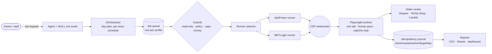

<div align="center">

# Automate Ecom Store

**All-in-one, human-paced automation for Shopee, TikTok Shop and Lazada seller centers — driven through AdsPower / MKTLogin profiles and Playwright.**

[](https://github.com/sonaecom/Automate-Ecom-Store/actions/workflows/ci.yml)
[](LICENSE)
[](https://nodejs.org)
[](tests/unit)
[](https://playwright.dev)

[Quick start](#quick-start) · [Architecture](#architecture) · [Modules](#modules) · [Safety](#safety-ceilings) · [Docs](docs/) · [Tiếng Việt](#tiếng-việt)

</div>

---

## What it does

Automate Ecom Store is an agent skill plus a small Node.js runtime for staff who operate their **own** marketplace stores. A staff member names a job — *invite affiliates*, *edit a listing*, *sync stock*, *reply to chats*, *daily report* — and the agent:

1. reads the safety rules first,
2. opens the store's own anti-detect browser profile (AdsPower or MKTLogin) in a **visible** window,
3. attaches Playwright to that profile's single tab,
4. performs the job on the normal seller-center pages at a human pace, under hard per-hour and per-day ceilings,
5. records every write in an idempotency journal and produces a report.

No direct marketplace APIs, no internal endpoints, no request replay, no headless mode.

## Features

### Shopee
- **Affiliate invites** — creator scoring, owner-approved ranked shortlist, batched invites (the most proven path).
- **Affiliate follow-up** — KOL chat templates, FAQ, keep / remind / review labels.
- Listing edits and new product listings (variation + image required), stock & price sync.
- Vouchers & promotions as owner-approved proposals; ads (GMV Max) read and bounded changes.
- Customer chat replies (template-based, existing threads only), review replies, order handling.
- Shop homepage decoration, daily report from two in-store sources.

### TikTok Shop
- Creator outreach / affiliate invites via the shared affiliate plan.
- Listing edits, product listings, stock & price sync, promotions, ads, customer chat, shop decoration, daily report.

### Lazada
- Affiliate invites, listing edits, product listings, stock & price sync, promotions, ads, customer chat, shop decoration, daily report.

> TikTok Shop and Lazada modules are templates refined after supervised runs; see [module status](#modules).

### Cross-platform
- Orchestrator day plan for up to 10 stores with one job queue per profile.
- Policy gate (blocks star asks, review rewards, off-platform contacts, scrape floods).
- Read-only money views: fees, settlement, wallet, ads spend, FX to VND — exact export figures with a second source.
- Optional Next.js dashboard and optional Google Sheets reports.

## Architecture



| Layer | Path |
| --- | --- |
| Skill entry & router | `skills/automate-ecom-store/SKILL.md` |
| Orchestrator & queue | `scripts/orchestrator.mjs`, `scripts/task-queue.mjs`, `scripts/unattended-tick.mjs` |
| Runners | `core/browser/adspower-runner.mjs`, `core/browser/mktlogin-runner.mjs`, `core/browser/runners.mjs` |
| Playwright actions | `core/browser/actions.mjs`, `core/browser/selectors/` |
| Guards | `core/safety/read-only.mjs`, `core/policy/`, `core/targets.mjs`, `core/pace.mjs` |
| Journal | `core/journal/action-key.mjs` |
| Module manifests | `core/manifest/*.manifest.json` |
| Dashboard | `dashboard/web` (Next.js, sample data only) |

More: [docs/architecture.md](docs/architecture.md).

## Modules

| Module id | What it does | Status |
| --- | --- | --- |
| `affiliate.invite` | Score creators, owner approves shortlist, invite in batches | ✅ Stable on Shopee · 🧪 Beta TikTok Shop / Lazada |
| `affiliate.post-invite` | KOL follow-up: keep / remind / review | 🧪 Beta |
| `listing.edit` | Edit existing listings with two-step QC | 🧪 Beta |
| `listing.product` | Create new product listings | 🧪 Beta |
| `ads.read` | Read ads spend & metrics (read-only) | 🧪 Beta |
| `ads.change` | Bounded ads setting changes; budget = owner approval | 🧪 Beta |
| `customers.chat` | Template replies in existing threads | 🧪 Beta |
| `inventory.stock-price` | Stock & price sync; big price cuts = proposal | 🧪 Beta |
| `selling.promotion` | Voucher / promotion drafts, owner approves | 🧪 Beta |
| `orders.handling` | Mark shipped only with pickup time; cancel vs return | 🧪 Beta |
| `reviews.replies` | One reply per review, policy-gated | 🧪 Beta |
| `ops.daily-report` | Daily figures cross-checked across two sources | 🧪 Beta |
| `homepage.decoration` | Shop decoration plan, owner approves each slot | 🧪 Beta |
| `content.video-live` | Video / live scan and posting plan | 🧪 Beta |

**Beta** = code, manifest and unit tests exist; real-store supervised runs are still in progress. Full details: [docs/modules.md](docs/modules.md).

## Quick start

### 1. Install on a VPS

Linux VPS with a desktop/virtual display, headed AdsPower or MKTLogin, Node.js ≥ 22. See [docs/deployment-vps.md](docs/deployment-vps.md).

```bash
git clone https://github.com/sonaecom/Automate-Ecom-Store.git
cd Automate-Ecom-Store/skills/automate-ecom-store
npm install
npx playwright install chromium
```

As an OpenClaw skill:

```bash
openclaw skills install ./Automate-Ecom-Store/skills/automate-ecom-store
```

### 2. Environment

Copy [`.env.example`](.env.example) to a file **outside** the repo (or export in your shell / systemd unit):

```bash
export ADSPOWER_API_BASE="<ADSPOWER_LOCAL_API_URL>"
export ADSPOWER_API_KEY="<ADSPOWER_API_KEY>"
export MKTLOGIN_API_BASE="http://localhost:4980"   # only for runner: mktlogin
```

### 3. Run one module with a tiny limit

```bash
node scripts/real-test.mjs \
  --store <PROFILE_ID> \
  --module listing.edit \
  --platform shopee \
  --round 1 \
  --max-actions 3 \
  --day YYYY-MM-DD \
  --journal file
# add --runner mktlogin to use MKTLogin
```

The round log stores a hash of the store id, never the id itself.

## Per-store config

Each owner keeps a private `~/.automate-ecom-store/stores.yaml` (mode 600). Caps and targets (`modules/affiliate/targets.example.yaml`) are **set by each owner** and are never hard-coded; an empty target is not filled up to the ceiling. Example: [examples/stores.yaml](examples/stores.yaml).

```yaml
stores:
  - label: "<STORE_A>"
    platform: shopee          # shopee | tiktokshop | lazada
    market: "<MARKET>"
    profile_id: "<PROFILE_ID>"
    runner: adspower          # adspower (default) | mktlogin
    mode: read_only           # read_only (default) | full
    caps:
      session: { listing_edits: 8, affiliate_invites: 20, ads_changes: 2, chat_replies: 8 }
      daily:   { listing_edits: 8, affiliate_invites: 20, ads_changes: 2, chat_replies: 8 }
```

See [docs/configuration.md](docs/configuration.md).

## Safety ceilings

Ceilings, not targets. A configured cap above a ceiling is ignored.

| Rule | Value |
| --- | --- |
| Affiliate invites | ≤ 2,000 / day and ≤ 100 / hour, batches of ~10 |
| Listing edits | ≤ 40 / hour |
| Ads changes | ≤ 10 / hour |
| Work rhythm | batches of 40–50 min, then 10–20 min breaks; seller sessions 2–3 h apart |
| Browser | one profile per store, one tab, one fixed proxy per profile, headed only |
| Captcha | at most one slider drag, then screenshot + pause the store (≥ 30 min) |

Full rules: [docs/safety-rules.md](docs/safety-rules.md) and `skills/automate-ecom-store/account-safety.md`.

## Security

- **No direct marketplace APIs**, internal endpoints, request replay, or injected scripts.
- **No secrets in the repo** — keys, IPs, profile ids, shop/staff names stay on the shop computer (`local/`, `*.local*` are gitignored).
- **Read-only stores are enforced in code** (`core/safety/read-only.mjs`).
- **Money actions need owner approval**: top-up, withdraw, pay, budget, refunds and big price cuts are refused or turned into proposals.
- CI runs gitleaks, a secret scan, a repo-hygiene scan and a private-name scan on every push.

Report vulnerabilities per [SECURITY.md](SECURITY.md).

## Testing

```bash
cd skills/automate-ecom-store
npm test                                   # node --test ../../tests/unit/*.test.mjs
cd ../..
node skills/automate-ecom-store/scripts/secret-scan.mjs .
node skills/automate-ecom-store/scripts/repo-hygiene.mjs .
node skills/automate-ecom-store/scripts/pre-push-private.mjs
git config core.hooksPath .githooks        # run the scans before every push
```

Runner tests use mocked AdsPower / MKTLogin HTTP servers; no real store is touched.

## Roadmap

- [x] AdsPower and MKTLogin runners, shared guards
- [x] Shopee affiliate invite (proven path)
- [x] Orchestrator, job queue, idempotency journal
- [ ] Supervised real-store runs for every Beta module *(planned)*
- [ ] TikTok Shop / Lazada selector hardening *(planned)*
- [ ] Dashboard fed from live run logs instead of samples *(planned)*

## Contributing

See [CONTRIBUTING.md](CONTRIBUTING.md) and [CODE_OF_CONDUCT.md](CODE_OF_CONDUCT.md). Changes are listed in [CHANGELOG.md](CHANGELOG.md).

## License

[MIT](LICENSE)

---

## Tiếng Việt

Một skill cho nhân viên vận hành **shop của chính mình** trên Shopee, TikTok Shop, Lazada. Nhân viên nhắn việc (mời affiliate, sửa listing, tồn kho, khuyến mãi, ads, chat, báo cáo); agent đọc luật an toàn, mở profile AdsPower/MKTLogin (cửa sổ hiện), làm trên một tab với nhịp người, và dừng gọi bạn khi gặp captcha.

1. **Cài:** `git clone https://github.com/sonaecom/Automate-Ecom-Store.git && openclaw skills install ./Automate-Ecom-Store/skills/automate-ecom-store`
2. **Mở AdsPower** (không bật chế độ ẩn), dán API Key khi agent hỏi. Key lưu trên máy, mode 600.
3. **Chọn profile theo số**, trả lời phỏng vấn ngắn (có thể bỏ qua).
4. **Nói việc cần làm**, ví dụ "mời affiliate Shopee".

Nhắn `reset config` để nhập lại key, `phỏng vấn lại` để làm lại phỏng vấn. Không đưa khóa, IP, profile id, tên shop hay tên người vào git.
