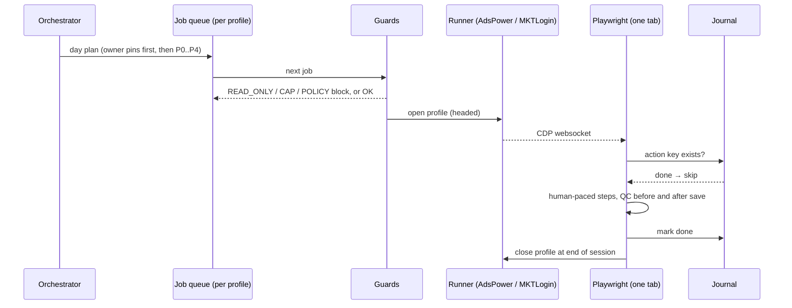

# Architecture

## Components

| Component | Path | Role |
| --- | --- | --- |
| Router | `skills/automate-ecom-store/SKILL.md` | Maps a job to one module file |
| Orchestrator | `scripts/orchestrator.mjs` | Day plan for up to 10 stores; night window; captcha pauses only that store |
| Queue | `scripts/task-queue.mjs` | One queue per store profile; long work chunked inside a session |
| Unattended tick | `scripts/unattended-tick.mjs` | Timer-driven step (see `deploy/systemd/automate-ecom-tick.timer`) |
| Runners | `core/browser/adspower-runner.mjs`, `mktlogin-runner.mjs`, `runners.mjs` | Open/close a profile, return CDP websocket |
| Actions | `core/browser/actions.mjs`, `core/browser/selectors/` | Shared page work: navigation, typing, scrolling, pop-ups |
| Pace | `core/pace.mjs`, `scripts/delay-range.mjs` | Human-like gaps, bursts, batch rests |
| Ceilings | `core/targets.mjs`, `scripts/caps-counter.mjs` | Hourly / daily hard caps |
| Read-only guard | `core/safety/read-only.mjs` | Blocks writes and money movement unless `mode: full` |
| Policy gate | `core/policy/`, `scripts/policy-gate.mjs`, `policies/` | Marketplace rules (star asks, rewards, off-platform contact, floods) |
| Journal | `core/journal/action-key.mjs` | `store|module|action|target|day` idempotency |
| Manifests | `core/manifest/*.manifest.json` | Declares each module's intents |
| Reports | `scripts/daily-report.mjs`, `scripts/push-sheets.mjs`, `dashboard/web` | CSV, optional Sheets, optional dashboard |

## Runners

A runner only opens and closes a profile and returns a websocket. Everything after that — tab reuse, pacing, captcha handling, guards — is shared code, so AdsPower and MKTLogin behave identically. Choose per store with `runner:` in `stores.yaml`.
